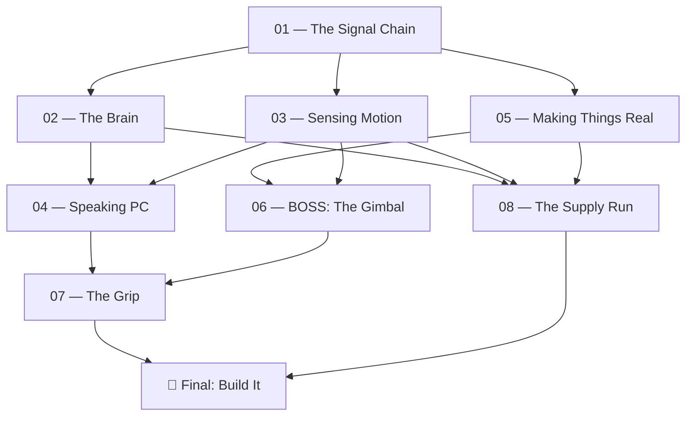

# 00 — Quest Map

You have an idea: a flight stick you built yourself. Between you and that is a chain of things you don't know yet. Each quest below unlocks one link.

## 1. The Rules

1. **No answers live in this vault until you write them.** Every quest is questions only.
2. **Leave Obsidian to find answers.** Datasheets, YouTube teardowns, forums, open-source projects, textbooks, people.
3. **Write your answer under each cue in your own words**, then cite where you found it.
4. **A quest is complete when you pass its Feynman Check**, meaning you can explain it out loud to someone who's never heard of it.
5. **Hints are a last resort.** Each one costs you pride, not points.

## 2. The Skill Tree

## 3. Progress

- [ ] 01 — The Signal Chain
- [ ] 02 — The Brain
- [ ] 03 — Sensing Motion
- [ ] 04 — Speaking PC
- [ ] 05 — Making Things Real
- [ ] 06 — **BOSS:** The Gimbal
- [ ] 07 — The Grip
- [ ] 08 — The Supply Run

> [!success] What you unlock
> Each completed quest lets you fill in one of your real project documents: **Design Decisions**, **BOM**, **Wiring**, and eventually the **firmware**. The quests are how you earn the right to write those.

## 4. Callout Legend

- `Retrieval Cue`: the question. Go find out.
- `Field Mission`: something to *do*, not just read. Watch, take apart, sketch, test.
- `Hint`: a direction to look, never the answer.
- `Feynman Check`: the exit exam for the quest.
- `Unlocks`: what you're allowed to build or decide once you're done.
